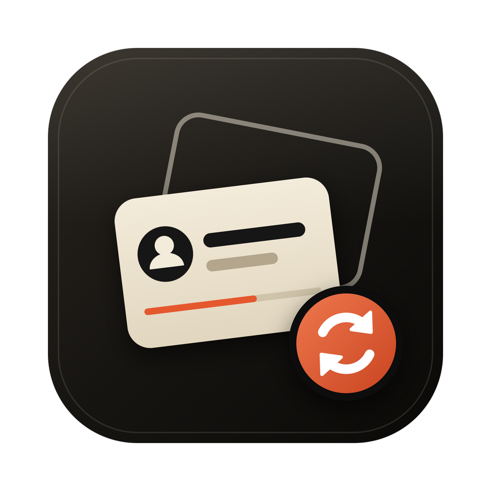

<p align="center">
  
</p>

<h1 align="center">Account Deck</h1>

<p align="center"><em>A quiet ledger of the accounts you keep.</em><br>
One click changes who is signed in to Claude, Claude Code, Codex, Cursor and Antigravity, and you can see each account's usage at a glance.</p>

---

Plenty of us have more than one account: a personal one and a work one, or a second seat for when the first runs out. These tools each allow one signed-in account at a time, and signing out and back in is slow. Worse, signing out inside the tool usually ends that login on the service's side too.

Account Deck keeps a saved copy of every account you sign in with and switches between them in a click. It lives in the menu bar (macOS) or the system tray (Windows and Linux), and it has a window that shows every account with its usage limits.

- **Switch in one click.** Pick an account from the menu bar, or press **Switch** in the window. Apps that need it are closed and reopened for you, already signed in.
- **New sign-ins are picked up automatically.** Sign in to a new account the usual way and it appears in the deck on its own.
- **Usage at a glance.** 5-hour and weekly limits for Claude Code and Codex, and model usage for Cursor, with reset times.
- **Local only.** Logins are stored on your computer. The deck talks to nothing but each tool's own service, and only to read usage or check that a saved login still works.

## Supported tools

| Tool | What the deck switches | Restarts the app | Usage |
|---|---|---|---|
| **Claude** (desktop app) | The claude.ai sign-in cookies, the app's account id and token caches, and the page's own local data for that account | Yes | Not shown |
| **Claude Code** (CLI) | The `claudeAiOauth` login and its account-bound entries in the keychain or `~/.claude/.credentials.json`, plus `oauthAccount` in `~/.claude.json` | No | 5-hour and weekly limits |
| **Codex** (CLI and ChatGPT app) | `~/.codex/auth.json` | ChatGPT app, if open | 5-hour and weekly limits, credits |
| **Cursor** | The `cursorAuth/*` login rows and the account's privacy-mode setting in Cursor's `state.vscdb` | Yes | Cursor and other model usage |
| **Antigravity** (experimental) | The sign-in rows in Antigravity's `state.vscdb` | Yes | Signed-in account only |

Some things are deliberately left alone: your own model-provider API keys in Cursor, MCP server sign-ins in Claude Code, and anything each app already files per account by itself. The comment at the top of each file in [`providers/`](providers) spells out exactly what is moved and why.

## Install

Download the build for your system from the releases page, or build it yourself (see [Development](#development)).

| System | File |
|---|---|
| macOS (Apple silicon) | `Account Deck-<version>-arm64.dmg` |
| Windows (x64) | `Account Deck Setup <version>.exe` |
| Linux (x64) | `Account Deck-<version>.AppImage` |

The builds are not code-signed. On macOS, the first time, right-click the app and choose **Open**, or run:

```bash
xattr -dr com.apple.quarantine "/Applications/Account Deck.app"
```

On macOS the deck asks for keychain access once per tool, for two reasons: Claude Code keeps its login in the keychain, and reading account names and usage for Cursor and the Claude app needs their storage keys. You can deny the storage-key prompts; switching still works without them.

## Using it

1. **Sign in as usual.** Whatever account each tool is signed in to now shows up in the deck by itself.
2. **Add another account.** Press **+ Add account** on that tool's column, or **Add account…** in the menu bar. The tool is signed out *on this computer only* and reopens at its sign-in screen. Sign in with the other account and it is saved too.
3. **Switch.** Press **Switch** on any saved account, or click it in the menu bar.

> **Never use "Log out" inside the tool itself.** Claude, Claude Code and Cursor all end the login on their servers when you sign out from inside them, so the saved copy stops working. Use **Add account** in the deck instead: it keeps every saved login valid. If a saved login has been ended anyway, its card shows **Sign in again**, which gets it back the same safe way.

Other things you can do:

- **Rename** an account, for example "work" and "personal", so you can tell them apart.
- **Refresh** an account's usage now. Usage is otherwise refreshed every 45 seconds in the background.
- **Remove** an account from the deck. Its saved login is deleted from this computer; nothing changes on the service.
- **Start at login**, from the menu bar.
- **Pick a theme** (Auto, Light or Dark) at the top right of the window. Auto follows your system setting; a choice you make is remembered.

Switching the Claude desktop app restarts it, which ends any Claude Code session running inside it.

## Privacy and security

- Saved logins are kept in `~/.account-deck`, one file per account. The folder is readable only by your user (`0700`) and the files are `0600`.
- These files are **not encrypted by the deck**. Cursor's tokens and the Claude app's cookies stay encrypted with those apps' own keys, but Claude Code and Codex tokens are stored as the tools themselves store them on Linux and Windows: as plain JSON. Anyone who can read your home folder can read them, just as they could read the tools' own files.
- The window is a local page served on `127.0.0.1` only. Every request must carry a random token that changes each run, and requests for any other host name are refused.
- The deck makes network requests only to each tool's own service: to read usage, to renew a saved login that is not signed in, to check that a saved login is still valid before switching to it, and (for Claude Code) to ask which account a login belongs to. There is no telemetry.

## How it works

Every tool keeps its login in a few known places: a file, a keychain item, rows in a SQLite database, or browser cookies. For each tool, a provider in [`providers/`](providers) knows:

- **`readLive()`**: who is signed in right now, and the exact data that makes up that login.
- **`writeLive()`**: how to put a saved login back in place.
- **`clearLive()`**: how to sign out on this computer only, without telling the service.
- **`quit()` and `launch()`**: how to close and reopen the app, for tools that only read their login at startup.

The server ([`server.mjs`](server.mjs)) polls each provider every few seconds. A login it hasn't seen is saved, and a saved one is kept current as tokens rotate. When a known account appears with a different sign-in, the deck waits 10 seconds for it to settle, so a sign-in caught halfway is never saved under the wrong account. A switch closes the app, saves the latest state of the account being left, writes the chosen one, and reopens the app.

The Claude desktop app needs the most care. It is the claude.ai page in a window, so the real login is the site's session cookie. The app also keeps the account it expects, and if that doesn't match the cookie it throws away its tokens. And the page keeps its own local data for the signed-in account. The deck moves all three together, while the app is closed.

## Development

Requires Node.js 22 or newer (the deck uses the built-in `node:sqlite`).

```bash
npm install
npm start           # the menu bar / tray app
npm run web         # just the page, at http://127.0.0.1:4777
```

Build installers:

```bash
npm run dist:mac
npx electron-builder --win --x64
npx electron-builder --linux --x64
```

Output goes to `dist/`.

The logo is generated from code. Edit [`assets/make-logo.mjs`](assets/make-logo.mjs), then:

```bash
npm run icons
```

That writes `assets/logo.svg` and `assets/tray.svg` and renders every PNG and the macOS `.icns` from them. (The renderer doesn't always quit by itself; press Ctrl+C after it prints "rendered all icons".)

### Settings for testing

These environment variables point the deck at other locations, so you can try changes on copies instead of your real logins:

| Variable | Default |
|---|---|
| `ACCOUNT_DECK_HOME` | `~/.account-deck` |
| `PORT` | `4777` (any free port if taken) |
| `ACCOUNT_DECK_SETTLE_MS` | `10000` |
| `CLAUDE_CONFIG_DIR` | `~/.claude` (Claude Code's own setting) |
| `CODEX_HOME` | `~/.codex` (Codex's own setting) |
| `CURSOR_DB`, `ANTIGRAVITY_DB` | the editor's `User/globalStorage/state.vscdb` |
| `CLAUDE_DESKTOP_CONFIG`, `CLAUDE_DESKTOP_COOKIES`, `CLAUDE_DESKTOP_DATA` | the Claude app's `config.json`, `Cookies` and data folder |

### Project layout

```
main.mjs            menu bar / tray app (Electron)
server.mjs          local server: polling, saving, switching
public/index.html   the window
lib/store.mjs       saved accounts on disk
lib/vscdb.mjs       shared helpers for VS Code-style editors
providers/          one file per tool
assets/             logo source and rendered icons
build/              installer icons
```

### Adding a tool

Add a file to `providers/` that exports an object with `id`, `name`, `restart`, `signInHint`, `detect()`, `readLive()`, `writeLive()`, `clearLive()` and `fetchUsage()`, plus `quit()` and `launch()` if the app has to be restarted. Then register it in `PROVIDERS` in `server.mjs`. Write down at the top of the file exactly what you save and what you leave alone, and why. Test against copies of the tool's files using the variables above, never against your own logins.

## Contributing

Issues and pull requests are welcome. These tools change their storage between versions, so the most useful report says which tool and version broke, what the deck showed, and the relevant lines from the tool's own log. Please never paste tokens, cookies or the contents of `~/.account-deck`.

## Disclaimer

Account Deck is an independent project. It is not affiliated with, endorsed by, or supported by Anthropic, OpenAI, Anysphere (Cursor) or Google. It works with files these tools keep on your computer, and those can change in any update. Check that using several accounts is allowed by each service's terms for your plan.

## License

[MIT](LICENSE)
